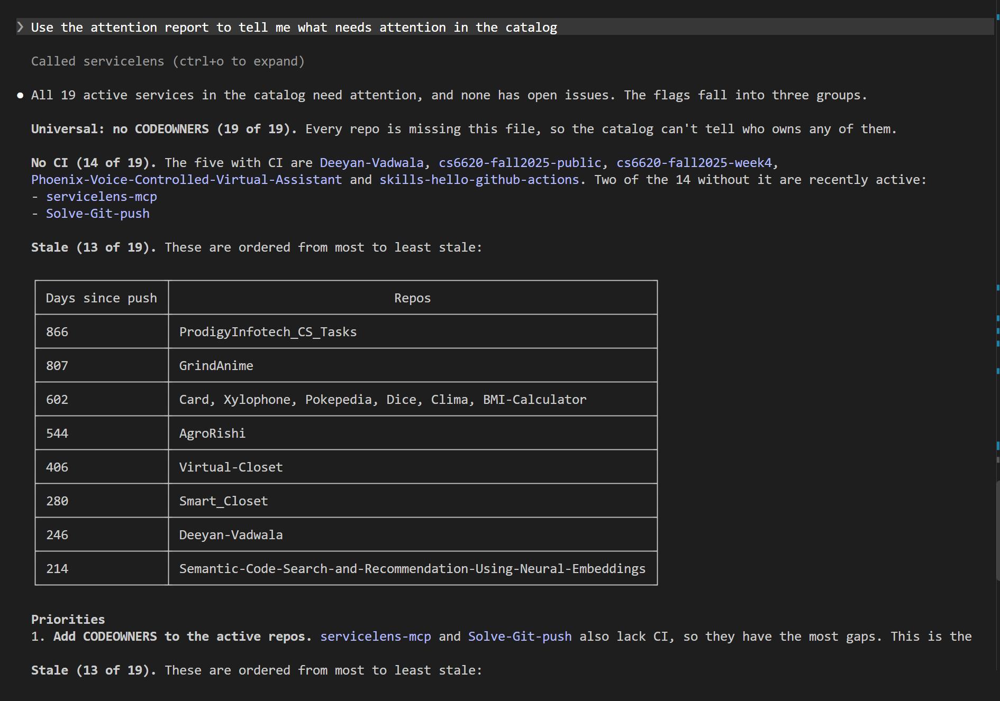
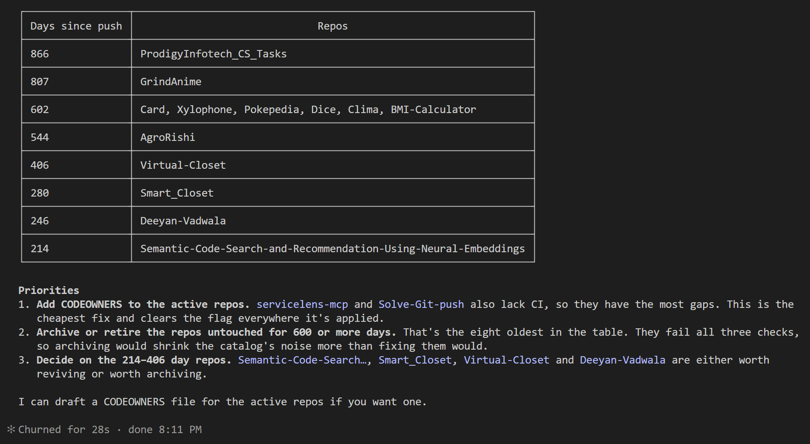
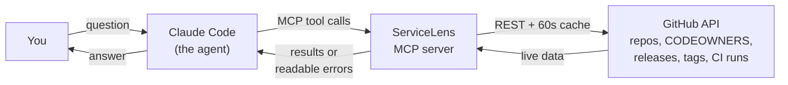

# ServiceLens


An [MCP](https://modelcontextprotocol.io) server that lets an AI agent answer questions about a service catalog using live data. Ask "who owns this service?" or "what needs attention?" in plain English and the agent calls real tools instead of guessing.

ServiceLens treats every public repository under a GitHub user or organization as a **service**:

| Question | Where the answer comes from |
|---|---|
| Who owns it? | The repo's `CODEOWNERS` file, falling back to the account that owns the repo |
| What version is it? | The latest GitHub release, falling back to the latest git tag |
| Is it healthy? | The status of the latest GitHub Actions run on the default branch |
| Is it neglected? | Days since the last push |




## Architecture



The agent decides which tools to call from each tool's name, description, and input schema. The server holds no data of its own, so every answer reflects GitHub at the moment you ask.

## What makes it more than an API wrapper

The `attention_report` tool combines ownership, CI status, and activity across every service and returns a ranked list. No single GitHub endpoint answers "what should I fix first?", so the server joins several signals, and the agent turns the result into a prioritized plan.

## Tools

| Tool | What it does |
|---|---|
| `list_services` | Names of all services in the catalog |
| `search_services` | Find services by name, description, language, or topic |
| `get_service` | Full overview: owner, version, language, issues, last push, URL |
| `get_service_owner` | Owner from CODEOWNERS, or the repo account if there is none |
| `get_service_version` | Latest release or tag |
| `get_service_health` | Status of the latest CI run |
| `unhealthy_services` | Services with failing CI, plus a count of services with no CI at all |
| `stale_services` | Services with no pushes in N days (default 90) |
| `services_without_owner` | Services with no CODEOWNERS file |
| `services_without_ci` | Services with no CI history, so their health is unknown |
| `attention_report` | One ranked report combining all of the above |

All tools are **read-only**.

## Setup

Requires Python 3.10+. Tested with `mcp` 2.3.0 and Claude Code 2.1.325.

```bash
python -m venv .venv
.venv\Scripts\Activate.ps1        # macOS/Linux: source .venv/bin/activate
pip install -r requirements.txt
```

Connect it to Claude Code (use absolute paths to the venv's Python):

```bash
claude mcp add servicelens -e GITHUB_TOKEN=<your token> -- <path-to>/.venv/Scripts/python.exe <path-to>/servicelens_server.py
```

Then start `claude` and ask, for example:

- "What needs attention in the catalog?"
- "Who owns the payments service and what version is it at?"
- "Which services haven't been touched in six months?"

### Configuration

| Variable | Purpose | Default |
|---|---|---|
| `GITHUB_OWNER` | The GitHub user or org to use as the catalog | `deeyanvadwala` |
| `GITHUB_TOKEN` | Optional. Raises the API limit from 60 to 5,000 requests per hour | none |

A fine-grained token with **public repositories, read-only, and no permissions** is enough. Never commit a token.

## Tests

22 offline unit tests cover CODEOWNERS parsing, version fallback, CI health, staleness, the attention report, rate-limit handling, and error messages. GitHub is replaced with fake data, so they make no network calls.

```bash
python -m unittest -v
```

## Evals

Unit tests show the code is correct. The evals show an agent can use the tools to answer real questions correctly. `evals/run_evals.py` asks 10 questions through Claude Code, which calls this server, and checks each answer for expected facts.

```bash
python evals/run_evals.py              # run all 10
python evals/run_evals.py --only 3     # run one case
python evals/run_evals.py --list       # show the cases
```

**Latest result: 10/10 passed** (details in `evals/last_run.json`).

Cases include the unhappy paths: a service that doesn't exist, a repo with no releases, and a health question where most services have no CI. In that last case the agent must say the services are unmonitored, not that they are healthy.

The expected answers depend on the live data of the demo account. If you point `GITHUB_OWNER` at a different account, update `evals/cases.json` to match.

## Design decisions

- **Few small tools, not one big one.** Each tool has a clear docstring, because the model reads it to decide which tool to call.
- **Errors come back as readable text.** An unknown service name returns "No service named 'x'... Use list_services to see valid names", so the agent can recover. An early eval run showed the agent could not see a raised exception's detail, so tools now return the message instead.
- **Honest about missing data.** Most repos have no CI, so "nothing is failing" is not the same as "everything is healthy". `unhealthy_services` reports the no-CI count with a note, and an eval enforces it.
- **Read-only by design.** There are no write tools, and the token needs no permissions beyond reading public data.
- **No extra dependencies.** HTTP calls use the standard library, and responses are cached for 60 seconds to save rate limit.
- **Failures degrade gracefully.** If the rate limit is hit partway through `attention_report`, it returns what it has, marked `incomplete`, instead of failing outright.

## Limitations and what I'd do in production

- Multi-repo tools check at most 30 repos (20 for `unhealthy_services`) to stay within the API rate limit. Production would use the GraphQL API or a cache to cover everything.
- CODEOWNERS parsing returns the owners of the first rule. A real implementation would match rules to paths.
- CI health uses the latest GitHub Actions run only, not other CI systems.
- Authentication, multi-user access, and a remote (HTTP) transport are not implemented. The server runs locally over stdio.
- The catalog source is GitHub. Swapping in Backstage would change only the data layer, since the tool interfaces would stay the same.

## Project layout

```
servicelens_server.py     the MCP server
requirements.txt          pinned dependency (mcp 2.x)
.github/workflows/        CI: runs the unit tests on every push
tests/                    offline unit tests
evals/                    eval cases, runner, and latest results
docs/                     screenshots
```